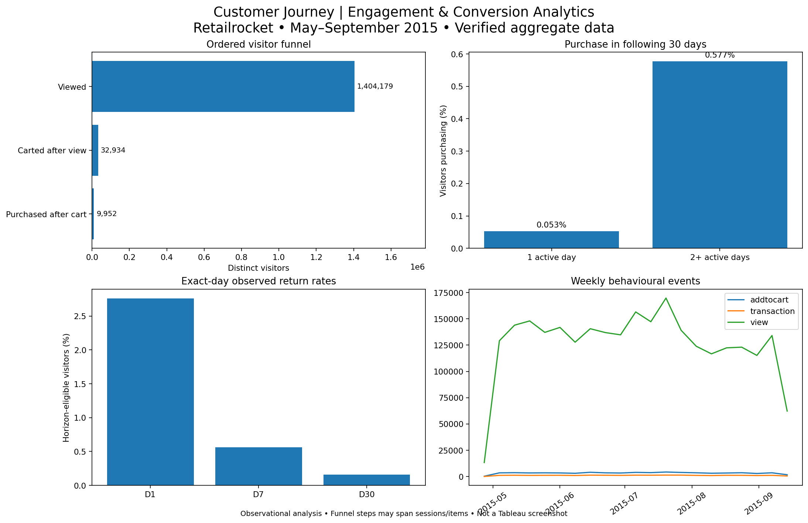

# E-Commerce Customer Behaviour & Conversion Analytics

**Python · SQL · DuckDB · pandas · SciPy · statsmodels · Tableau Public**

> **Execution status:** Source events independently validated against the supplied Retailrocket CSV using pandas; verified findings below. DuckDB pipeline executed locally against the Retailrocket dataset; all 11 automated tests passed. Tableau Public dashboard is not yet published.

## Business question
Where do observed customers disengage in the e-commerce journey, how does early engagement relate to future conversion, and which product questions should be tested next? This reproducible case study uses the public [Retailrocket dataset](https://www.kaggle.com/datasets/retailrocket/ecommerce-dataset), with **2,756,101 verified event records** (May 3–September 18, 2015).

## Verified findings (independent pandas audit)
- **2,756,101 events** from **1,407,580 visitors**, including **2,664,312 views**, **69,332 cart events**, and **22,457 transactions**.
- **Ordered visitor funnel:** 1,404,179 viewing visitors → 32,934 later carting visitors → 9,952 later purchasing visitors. The **cart-to-purchase progression was 30.22%**, corresponding to a **69.78% observed funnel drop-off**; this is not checkout abandonment.
- **Pre-outcome cohort comparison:** Among 1,066,890 eligible visitors, subsequent 30-day purchase conversion was **0.5767%** for first-week multi-day visitors (354/61,381) versus **0.0527%** for single-day visitors (530/1,005,509). Difference: **0.524 percentage points** (95% CI: 0.467–0.587 pp). Observational, not causal.
- **Exact-day observed returns:** D1 **2.760%**, D7 **0.561%**, D30 **0.157%**; each uses horizon-specific follow-up eligibility.
- **Data quality:** 460 exact duplicate rows flagged, not deleted; no missing timestamps, visitor IDs, or item IDs. Most null `transactionid` values are expected on non-transaction events.

See [`reports/verified_findings.md`](reports/verified_findings.md).

## What it demonstrates
- Multi-stage visitor-level **ordered** conversion funnel with SQL CTEs, conditional aggregation, `LEFT JOIN`s, and safe rate denominators.
- A 7-day **pre-outcome** engagement measurement followed by a disjoint 30-day purchase outcome; Wilson confidence intervals, Newcombe CI for a risk difference, and a separately implemented logistic-regression model.
- Weekly first-observed cohorts with D1/D7/D30 **exact-day** return metrics and right-censoring; separate retention and purchase metrics.
- Item-level event ratios subject to a 100-view support threshold; a point-in-time category mapping example when item properties are available.
- Executed DuckDB/SQL pipeline, data QA, automated SQL and export tests (11 passed locally), independently checked Tableau CSV exports, and a hypothetical checkout A/B experiment with power analysis.

## Tableau-ready exports and preview
Five aggregate CSVs under `data/processed/tableau/` were independently generated from real Retailrocket records and reconciled with the verified counts. `dashboard/analytics_preview.png` is an independently rendered **static preview**, not a published Tableau dashboard. To rebuild exports without DuckDB, run `python -m src.export_tableau_verified`.



## Run locally
Requires Python 3.11 or higher.

```bash
python -m venv .venv
source .venv/bin/activate    # Windows: .venv\\Scripts\\activate
pip install -r requirements.txt
# download and extract Kaggle CSV files; see data/README.md
python -m src.run_all
pytest -q
```

Outputs (ignored by Git): `data/processed/quality_report.json`, `statistics.json`, `experiment_power.json`, `retailrocket.duckdb`, five `data/processed/tableau/*.csv` files, and `reports/verified_findings.md` (generated from executed data). See [Tableau build guide](dashboard/README.md) and [experiment design](reports/experiment_design.md).

## Metric definitions
| Measure | Numerator | Denominator / ordering |
|---|---|---|
| View-to-cart % | visitors with cart **after** first observed view | visitors with at least one view |
| Cart-to-purchase % | visitors with purchase **after** first qualifying cart | visitors with qualifying cart |
| View-to-purchase % | visitors with both ordered milestones | visitors with view |
| Cart drop-off % | qualifying cart visitors without later qualifying purchase | qualifying cart visitors |
| Early-engagement conversion | visitors purchasing on days 7–37 after first event | first-observed visitors with complete 37-day coverage in engagement group |
| D7 return % | eligible cohort members active exactly 7 calendar dates after first observed date | first-observed cohort members with D7 follow-up |

**Important:** Funnel steps need not be for the same item, nor in one website session; strict millisecond ordering excludes ties. A purchase without previously observed cart is not counted in the ordered funnel even though it may be a valid transaction. Cart abandonment is a **proxy**, not verified checkout abandonment.

## Validation and limitations
`src/validate.py` checks event types, identifiers, transaction IDs, timestamp validity and duplicate patterns. Repeated event records are reported, not removed automatically. SQL tests check funnel ordering, outcome leakage and cohort censoring using an intentionally small fixture; test fixture data are **not** analytical results. Before interpreting observed outcomes, inspect counts, date coverage, invalid and unmatched property mappings. Correlation/regression is not causal inference. No revenue, customer acquisition, experiment results, actual product recommendation outcomes, or dashboard URL are fabricated.

## Validated aggregate export tests

The independent Tableau export audit runs **without DuckDB**: `python -m pytest -q tests/test_verified_exports.py`. SQL-focused tests in `tests/test_business_logic.py` require DuckDB and are skipped when it is absent. The optional point-in-time category analysis is in `sql/06_optional_category_mapping.sql` and is deliberately excluded from the default pipeline because it requires a potentially costly temporal join.

## Next actions after running the DuckDB pipeline
1. Verify `quality_report.json` and rerun if source data or schema differs.
2. Read `statistics.json`; write 3–5 concrete insights with numerators, denominators, uncertainty and caveats into `reports/insights.md`.
3. Assemble/publish Tableau dashboard using [guide](dashboard/README.md), then add actual screenshot and link.
4. Only then write specific achievement-based resume bullets from observed metrics.

Dataset attribution: **Retailrocket, E-Commerce Dataset** (Kaggle). Check current dataset usage terms before redistribution. Raw records and visitor-level extracts are intentionally excluded from Git.
